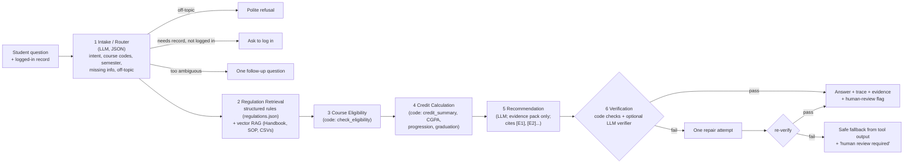

# Phase 9 — Agentic Extension

## 1. Goal

Assignment 1 produced a single-call RAG advisor: retrieve passages, put them in a long structured prompt with the student profile, and let one model call do everything. That includes understanding the question, finding the rule, checking prerequisites, adding up credits and writing the answer. Phase 9 splits this into separate components, each with one job. The question is whether that separation produces better advice, or just more moving parts.

Implementation: `agents.py` (`AgenticAdvisor`), with deterministic tools in `academic_tools.py`. It is selected in the UI with the "Advisor" switch (`Agentic (verified)` / `RAG (Assignment 1)`) and through `mode` in `/api/chat`.

## 2. Architecture

Everything the components produce goes into one **evidence pack** (`Evidence` class). Each item has an id (`E1`, `E2` …), a type (`regulation`, `document` or `tool`) and a source (a handbook clause, a PDF page, or a `courses.csv` row). The Recommendation agent may only use this pack, and the Verification agent checks against it.

## 3. Components: what each does and why it exists

| # | Component | Implemented as | What it does | Why it is a separate step |
|---|---|---|---|---|
| 1 | Intake / Router | LLM call returning JSON (`ROUTER_SYSTEM`), plus regex | Classifies intent (course_info, eligibility, credits_progress, graduation, course_planning, regulation, procedure_sop, off_topic, greeting); extracts course codes, including from names such as "machine learning", via a title index; finds the target semester ("next semester" = current + 1); lists missing information | Decides early whether to refuse, ask for login, or ask a follow-up, before spending calls on retrieval. This is the "knows when to ask" requirement made explicit. |
| 2 | Regulation Retrieval | Keyword topics → `data/regulations.json`, plus `periods.select_documents` (Chroma vector search) | Adds the matching structured rules (with clause and page) and up to k+2 document passages | Structured rules are exact and cite clauses. Vector RAG still covers anything not transcribed. The list `not_in_documents` is added for regulation questions so the model can say "this is not in the documents". |
| 3 | Course Eligibility | Code: `academic_tools.check_eligibility` | Returns one of ELIGIBLE, NOT_ELIGIBLE, CONDITIONAL, NEEDS_REVIEW, NOT_IN_CURRICULUM, ALREADY_PASSED, CURRENTLY_REGISTERED or NO_DATA_FOR_BATCH, with reasons and sources | Prerequisite logic is a lookup; a model should not "reason" it. The same function also generates the expected answers in the test set. |
| 4 | Credit Calculation | Code: `credit_summary`, `compute_cgpa`, `progression_status`, `graduation_check`, `semester_courses` | Credits per basket against minimums, CGPA from the grade table (Clause 8.16), progression thresholds (4.00 for Year 2, 5.00 for Year 3+), graduation conditions | Arithmetic over 50+ course records is where single-call LLMs make silent mistakes. |
| 5 | Recommendation | LLM (`RECOMMEND_SYSTEM`) | Writes the reply from the evidence and the *minimised* profile. Must cite `[E#]`. Must open with `**Decision: …**` when an eligibility result exists. Must flag conflicts and missing information and name who to ask. Under 220 words. | Language is what the LLM is good at: explaining a decision in plain words. |
| 6 | Verification | Code checks, plus an LLM verifier (`VERIFY_SYSTEM`, `AGENT_LLM_VERIFY=true`) | (a) decision label must match the tool; (b) no course codes outside the catalogue or evidence; (c) at least one citation, and every cited id must exist; (d) no restricted personal values; then the LLM verifier judges support. On failure: one repair with feedback. If it still fails: a safe fallback built only from tool output, status `unverified`, human review flagged. | Catches the failure that matters most: an answer that contradicts the rules. Adds the "say when not sure" behaviour structurally instead of hoping the prompt is followed. |

**Human-review flag.** `HUMAN_DECISIONS` maps topics such as programme transfer, change of minor, credit limits, grade review, late registration, attendance relaxation, audit and withdrawal to the person or body that decides. The flag is also raised for any NEEDS_REVIEW decision or failed verification, and the UI shows it as a "Needs a human decision" box.

**Trace in the UI.** Each answer has a collapsible "How this answer was made" panel. It lists every step with its duration and key outputs (intent and codes, number of rules and passages, decisions, CGPA and credits, verification issues), plus the evidence list with sources. This shows the student and the examiner *why*, not only *what*.

## 4. Code vs. LLM: the design rule

> Anything that is a lookup or arithmetic is done by code; the model is used for language: understanding the question and explaining the result.

| Task | Assignment 1 RAG | Agentic |
|---|---|---|
| Understand the question | LLM (implicit) | LLM (explicit JSON) |
| Find the rule | Vector similarity only | Structured rule by topic + vector similarity |
| Check prerequisites | LLM reads CSV rows in the prompt | Code |
| Credits and CGPA | LLM arithmetic over the JSON profile | Code |
| Batch-specific curriculum | Prompt instruction | Code (lookups by batch) |
| Write the answer | LLM | LLM, constrained to evidence |
| Check the answer | — | Code + LLM verifier |

## 5. How it is compared with RAG

Both systems run on the **same 42-case test set** (`eval/test_cases.json`), through `eval/run_eval.py --modes rag,rag_student,agentic`, with the same model and the same scoring rules (see `docs/evaluation_methodology.md`). Every student-specific expected decision is checked against the deterministic tools in `tests/test_ground_truth.py`. That makes the comparison fair for prose answers, but it also means the agentic system's tools agree with the expected answers *by construction*. We report this openly, and the RAG modes are scored the same way. Metrics:

| Metric | RAG (no student data) | RAG + student data (Asg 1) | Agentic |
|---|---|---|---|
| Correct (%) | [RESULT: run eval/run_eval.py] | [RESULT] | [RESULT] |
| Partially correct (%) | [RESULT] | [RESULT] | [RESULT] |
| Hallucinated / unsupported (%) | [RESULT] | [RESULT] | [RESULT] |
| Eligibility decisions correct (%) | [RESULT] | [RESULT] | [RESULT] |
| Source / evidence correct (%) | [RESULT] | [RESULT] | [RESULT] |
| Missing information handled (%) | [RESULT] | [RESULT] | [RESULT] |
| Conflicts flagged (%) | [RESULT] | [RESULT] | [RESULT] |
| Incorrect recommendations (count) | [RESULT] | [RESULT] | [RESULT] |
| Median latency (s, throttling excluded) | [RESULT] | [RESULT] | [RESULT] |
| LLM calls per answer | 1 | 1 | 2–5 (router, recommend, verifier; +2 on repair) |
| Avg tokens per answer | [RESULT] | [RESULT] | [RESULT] |

Per-category labels (general, missing_info, conflict, eligibility, progress, ambiguous, unavailable, off_topic) are in `eval/results/summary.md`. They show *where* the extra components help.

## 6. Expected trade-offs: when agentic complexity is not worth it

- **Simple handbook lookups** (T02 attendance 75%, T06 distinction 8.50, T08 add/drop two weeks). A good RAG retrieval already answers these. The agentic pipeline spends 2–3 extra model calls (router and verifier) for the same answer. That means higher latency and, on the free tier, faster use of the requests-per-minute and per-day quota (`LLM_MIN_INTERVAL_SECONDS=4` spacing). For these, a router that sends simple regulation questions straight to single-call RAG would be cheaper. [RESULT: compare latency/tokens on T01–T12]
- **Where it should pay off**: student-specific eligibility, credits, progression and graduation (E01–E13), source-data conflicts (C01–C05) and missing information (M01–M06). Here a single LLM call must do lookups and arithmetic over long JSON, and that is where silent errors occur. [RESULT: per-category comparison]
- **New failure points**: a router misclassification (e.g. not detecting that a question is personal) can skip the record entirely, and a too-strict verifier can replace a good answer with the terser fallback. Both are visible in the trace, which makes debugging easier than with one opaque call.
- **Engineering cost**: about 390 lines of orchestration (`agents.py`) and 500 lines of tools (`academic_tools.py`), against one prompt. The tools are reused by the evaluation, the data generator, the charts and the security layer, so the cost is shared.

Conclusion (to fill after the run): [RESULT: does the agentic version reduce hallucinations and incorrect recommendations enough to justify its extra calls and latency? On which categories is plain RAG just as good?]

## 7. Real data issues the deterministic layer surfaced

Writing exact code against the curriculum forced every inconsistency into view. A text-only RAG system silently blends these. All of them are now flagged in tool output (and on the charts) as source-data conflicts, and several are test cases.

**Prerequisite scheduled in the same semester as the course** (flag `prereq_X_scheduled_same_or_later_semester`):

| Batch | Course (semester) | Requires | Prerequisite's semester |
|---|---|---|---|
| 2022 | MATH205 (2) | MATH202 | 2 |
| 2023 | COMP206 (5) | COMP207 | 5 |
| 2024 | DATA404 (6) | DATA302 | 6 |
| 2025 | DATA404 (6) | DATA302 | 6 |
| 2025 | COMP302 (6) | COMP208 | 6 |
| 2026 | COMP302 (6) | COMP208 | 6 |

**Prerequisite not in that batch's curriculum** (flag `prereq_X_not_in_<batch>_curriculum`):
- 2023 DATA202 (Exploratory Data Analysis) requires MATH203, which is not in the 2023 curriculum (test C03).
- 2025 and 2026 DATA301 (Machine Learning) require DATA206, which does not appear in any batch's curriculum.
- 2025 ECON316 (Digital Economics, Economics minor) requires ECON201, but the 2025 minor offers ECON208 *Microeconomics I* instead, apparently renamed (test C02, decision NEEDS_REVIEW).

**Ambiguous titles**: in 2022, specialization slot DATA404 is a single code with the title "Multi Modal Learning / Cloud Computing" (flag `title_ambiguous_in_source`, test C05).

**Credit structure**: for batch 2026, `basket_requirements.csv` shows fixed minimum credits that differ from the scheduled credits (Univ Core 24 vs 18, Foundation 24 vs 26, Program CORE 46 vs 50; `differs = True`).

**Smaller ones**: course codes marked TBA (2025/2026 Language, 2026 Compiler Design, a 2025 track slot); minor courses with `CREDITS_TBD`; Open/Minor slots with no course code. These are shown as placeholders, never as invented courses.

These are useful findings for the university as much as for the advisor. The right behaviour, which we implemented, is to surface them and refer the student to the Faculty Advisor or Program Chair, not to guess.
